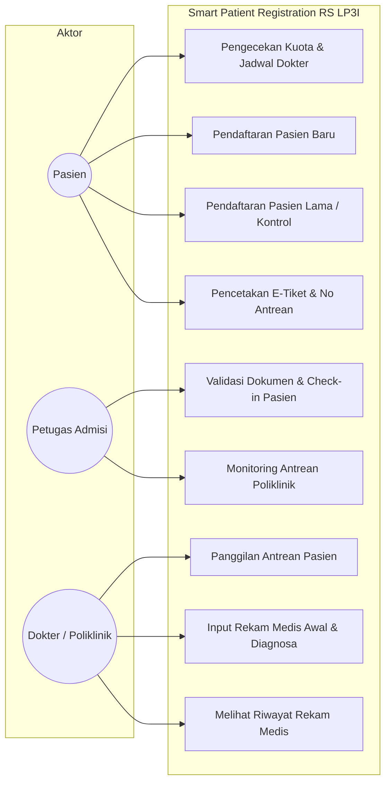
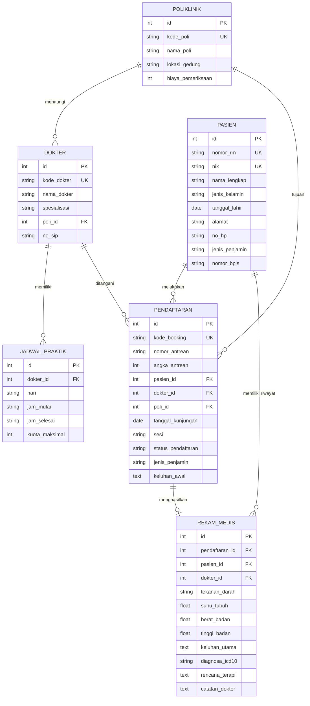
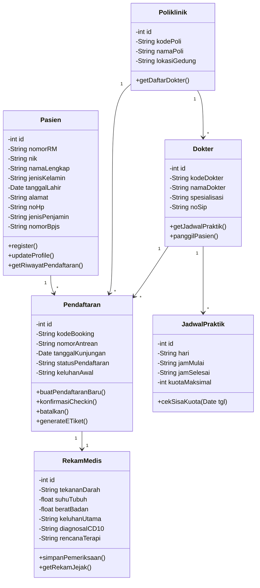

# LAPORAN TUGAS BESAR / UJIAN TENGAH SEMESTER (UTS)
## SISTEM INFORMASI MANAJEMEN (SIM) - SEMESTER 5 (4 SKS)
### TAHUN AKADEMIK 2026/2027

---

# APLIKASI PINTAR PENDAFTARAN PASIEN
## *(SMART PATIENT REGISTRATION SYSTEM)*
## RUMAH SAKIT POLITEKNIK LP3I JAKARTA

**Disusun Berdasarkan Metodologi *Software Development Life Cycle* (SDLC) - *Waterfall Model***

```
                     POLITEKNIK LP3I JAKARTA
   Jl. Kramat Raya No. 7-9, Gd. Sentra Kramat Blok A 15-17, Jakarta Pusat 10450
```

---

**Identitas Proyek & Ujian:**
- **Mata Kuliah:** Sistem Informasi Manajemen
- **Semester / SKS:** 5 / 4 SKS
- **Program Studi:** Manajemen Informatika
- **Peran Pengembang:** System Analyst & Lead Software Engineer
- **Dosen Penguji / Kaprodi:** Nasril, S.Kom., M.M.
- **Tanggal Pengesahan:** Oktober 2026

---

## DAFTAR ISI

1. [BAB I: ANALISIS KEBUTUHAN SISTEM](#bab-i-analisis-kebutuhan-sistem)
   - 1.1 Latar Belakang & Analisis Masalah (*Pain Points*) Pendaftaran Manual
   - 1.2 Kebutuhan Fungsional (*Functional Requirements*) Berdasarkan Aktor
   - 1.3 Kebutuhan Non-Fungsional (*Non-Functional Requirements*)
2. [BAB II: PERANCANGAN SISTEM (SYSTEM & SOFTWARE DESIGN)](#bab-ii-perancangan-sistem-desain--pemodelan)
   - 2.1 Pemodelan Proses Bisnis (Use Case Diagram & Activity Diagrams)
   - 2.2 Pemodelan Data (Entity Relationship Diagram & Class Diagram)
   - 2.3 Perancangan Arsitektur Sistem & Wireframe UI/UX
3. [BAB III: IMPLEMENTASI & PENGKODEAN (CODING)](#bab-iii-implementasi--coding)
   - 3.1 Justifikasi Pemilihan *Tech Stack* (Frontend, Backend, DBMS)
   - 3.2 Snippet Code Fungsionalitas Inti
     - 3.2.1 Algoritma Pengecekan Ketersediaan Kuota Dokter
     - 3.2.2 Endpoint REST API Penyimpanan Data Pendaftaran Pasien Baru
4. [BAB IV: PENGUJIAN SISTEM (TESTING)](#bab-iv-pengujian-sistem)
   - 4.1 Rancangan Pengujian *Black-Box Testing* (Tabel Skenario Uji)
   - 4.2 Pelaksanaan *Integration Testing* & *User Acceptance Testing (UAT)*
5. [BAB V: PEMELIHARAAN (MAINTENANCE) & KESIMPULAN](#bab-v-pemeliharaan--kesimpulan)
   - 5.1 Strategi Pemeliharaan Sistem (*Corrective, Adaptive, Perfective*)
   - 5.2 Standar Operasional Prosedur (SOP) Penanganan Bug Darurat & *High Availability*
   - 5.3 Kesimpulan & Saran Rekomendasi
6. [LAMPIRAN](#lampiran)
   - Lampiran 1: Diagram Mermaid Sistem Lengkap
   - Lampiran 2: Struktur Direktori & Kode Program Sumber

---

# BAB I: ANALISIS KEBUTUHAN SISTEM
*(Requirements Analysis & Definition)*

### 1.1 Latar Belakang & Analisis Masalah (*Pain Points*) Pendaftaran Manual
Rumah Sakit Politeknik LP3I Jakarta merupakan institusi pelayanan kesehatan yang melayani ratusan pasien setiap hari, baik pasien reguler (Umum) maupun peserta Jaminan Kesehatan Nasional (BPJS Kesehatan). Dalam operasional pendaftaran pasien rawat jalan saat ini, sistem yang berjalan masih didominasi oleh pencatatan fisik/semi-manual di loket admisi. Kondisi ini menimbulkan sejumlah hambatan operasional (*pain points*) yang signifikan:

1. **Penumpukan Antrean Fisik di Loket Pendaftaran (Bottleneck Waktu):**
   Pasien harus datang sangat pagi (pukul 05.30 - 07.00 WIB) hanya untuk mengambil nomor antrean fisik. Waktu tunggu pasien di ruang pendaftaran mencapai 60 hingga 120 menit sebelum berhasil menemui petugas admisi, yang mengakibatkan kelelahan pasien dan kepadatan ruang tunggu yang melebihi kapasitas.
2. **Tingginya Risiko Human Error pada Pencatatan Rekam Medis Awal:**
   Petugas admisi mencatat ulang identitas pasien secara manual dari KTP/kartu BPJS ke buku registrasi fisik atau spreadsheet lokal. Hal ini sering menimbulkan kesalahan ketik Nomor Induk Kependudukan (NIK), kesalahan ejaan nama, dan duplikasi Nomor Rekam Medis (No. RM) ganda untuk pasien yang sama.
3. **Ketidakpastian Kuota dan Jadwal Praktik Dokter Spesialis:**
   Pasien seringkali sudah mengantre berjam-jam di loket hanya untuk mengetahui bahwa kuota konsultasi dokter yang dituju telah habis atau dokter spesialis bersangkutan sedang berhalangan/izin dinas. Ketiadaan sistem informasi kuota transparan menimbulkan kekecewaan dan komplain pasien.
4. **Lambatnya Proses Verifikasi Kepesertaan Pasien BPJS Kesehatan:**
   Pemeriksaan keaktifan rujukan faskes tingkat pertama (FKTP) dan kartu BPJS dilakukan secara manual melalui pengecekan fisik lembar rujukan, memperpanjang durasi pelayanan per pasien hingga 7–10 menit di meja pendaftaran.
5. **Ketiadaan Rekapitulasi Data Terpusat Real-Time:**
   Pihak manajemen rumah sakit kesulitan memantau persebaran beban kunjungan antar-poliklinik, utilisasi jadwal praktik dokter, dan tren penyakit secara langsung untuk pengambilan keputusan strategis.

---

### 1.2 Kebutuhan Fungsional (*Functional Requirements*)
Sistem dirancang dengan pembagian hak akses (*Role-Based Access*) untuk 3 aktor utama: **Pasien**, **Petugas Pendaftaran (Admisi)**, dan **Dokter / Poliklinik**.

| Kode FR | Aktor | Deskripsi Kebutuhan Fungsional |
| :--- | :--- | :--- |
| **FR-PAS-01** | Pasien | Melakukan reservasi antrean dokter secara mandiri (online) melalui portal web/mobile. |
| **FR-PAS-02** | Pasien | Mendaftarkan diri sebagai **Pasien Baru** dengan mengisi data identitas valid (NIK, Nama, Tanggal Lahir, Alamat, No. HP, Penjamin: UMUM / BPJS). |
| **FR-PAS-03** | Pasien | Melakukan pendaftaran kontrol (**Pasien Lama**) hanya dengan memasukkan Nomor Rekam Medis (No. RM) atau NIK terdaftar tanpa perlu menginput ulang biodata. |
| **FR-PAS-04** | Pasien | Melihat jadwal dokter dan ketersediaan sisa kuota pelayanan secara real-time sebelum memilih tanggal kunjungan. |
| **FR-PAS-05** | Pasien | Menerima bukti pendaftaran berupa **E-Tiket Antrean Digital** yang memuat Kode Booking, Nomor Antrean Poli, QR Code, dan estimasi waktu pelayanan yang dapat diunduh/dicetak. |
| **FR-ADM-01** | Petugas Admisi | Melihat dashboard pemantauan antrean pasien terdaftar per hari secara real-time. |
| **FR-ADM-02** | Petugas Admisi | Melakukan validasi fisik/berkas kepesertaan (KTP & kartu BPJS) dan mengubah status pasien menjadi **TERKONFIRMASI (Check-in)** saat pasien tiba di rumah sakit. |
| **FR-ADM-03** | Petugas Admisi | Melakukan filter dan pencarian data registrasi berdasarkan tanggal kunjungan, poliklinik tujuan, status antrean, dan jenis penjamin. |
| **FR-ADM-04** | Petugas Admisi | Membatalkan pendaftaran (*Cancel*) jika pasien tidak hadir melewati batas toleransi panggilan. |
| **FR-DOK-01** | Dokter / Poli | Mengakses daftar tunggu antrean pasien polikliniknya yang telah berstatus *Terkonfirmasi (Hadir)*. |
| **FR-DOK-02** | Dokter / Poli | Memanggil pasien antrean secara berurutan dengan integrasi panggilan audio / visual. |
| **FR-DOK-03** | Dokter / Poli | Mengakses riwayat rekam medis terdahulu (*electronic health record*) milik pasien. |
| **FR-DOK-04** | Dokter / Poli | Menginput data pemeriksaan rekam medis awal (tanda vital: tensi, suhu, BB, TB; anamnesis/keluhan; diagnosa berbasis kode ICD-10; resep terapi), lalu menyelesaikan kunjungan (*Status: Selesai*). |

---

### 1.3 Kebutuhan Non-Fungsional (*Non-Functional Requirements*)
Aspek non-fungsional memastikan sistem aman, andal, cepat, dan sesuai dengan regulasi kesehatan di Indonesia.

1. **Keamanan Data Pasien & Kepatuhan Regulasi Medis (*Security & Compliance*):**
   - **Kepatuhan Regulasi:** Sistem tunduk pada **Undang-Undang Perlindungan Data Pribadi (UU PDP No. 27 Tahun 2022)** dan **Peraturan Menteri Kesehatan (Permenkes) No. 24 Tahun 2022 tentang Rekam Medis Elektronik (RME)**.
   - **Enkripsi Data:** Komunikasi data wajib dienkripsi menggunakan protokol **TLS 1.3 (HTTPS)** saat transit (*in-transit*). Data sensitif pasien (NIK dan ringkasan medis) dilindungi algoritma enkripsi **AES-256** pada tingkat penyimpanan (*at-rest*).
   - **Otorisasi & Otentikasi:** Menerapkan *Role-Based Access Control* (RBAC) dan session token berbasis JWT yang memiliki masa kedaluwarsa ketat.
   - **Audit Trail:** Setiap aktivitas akses, pembacaan, dan modifikasi data rekam medis dicatat dalam log audit yang tidak dapat diubah (*immutable log*) mencakup timestamp, user ID, dan alamat IP.

2. **Performa Sistem (*Performance*):**
   - **Waktu Respon Cepat:** Waktu respon (*response time*) API pengecekan kuota dokter dan pencarian pasien tidak boleh melebihi **< 1.5 detik** pada kondisi beban normal.
   - **Konkurensi Tinggi:** Sistem arsitektur backend mampu menangani hingga minimal **1.000 permintaan bersamaan (*concurrent requests*)** pada jam sibuk pagi hari tanpa penurunan performa.
   - **Integritas Transaksi:** Operasi pendaftaran dan alokasi kuota menggunakan mekanisme transaksi basis data tingkat isolasi *Serializable/Snapshot* untuk mencegah terjadinya *race conditions* (*overbooking* antrean).

3. **Ketersediaan & Keandalan (*Availability & Reliability*):**
   - **Tingkat Ketersediaan (*High Availability*):** Layanan ditargetkan memiliki *uptime* minimal **99.9%** (toleransi *downtime* terencana maksimal 43 menit per bulan di luar jam operasional).
   - **Strategi Backup:** *Automated Incremental Daily Backup* dan *Full Weekly Backup* ke penyimpanan terisolasi (*offsite cloud backup*) dengan *Recovery Point Objective* (RPO) < 2 jam dan *Recovery Time Objective* (RTO) < 30 menit.
   - **Pencegahan Kegagalan Jaringan:** Arsitektur dilengkapi *graceful degradation* di mana jika salah satu layanan eksternal (misal: verifikasi BPJS) lambat, pendaftaran tetap dapat diproses dalam mode antrean lokal (*offline-first queue*).

---

# BAB II: PERANCANGAN SISTEM
*(System & Software Design)*

### 2.1 Pemodelan Proses Bisnis

#### A. Use Case Diagram
Diagram use case memetakan interaksi antara aktor (Pasien, Petugas Admisi, Dokter) dengan modul fungsional dalam sistem:



#### B. Activity Diagram: Pendaftaran Pasien Baru
Menjelaskan tahapan ketika pasien belum pernah berobat sebelumnya:

```mermaid
activityDiagram
  (*) --> "Buka Portal Pasien"
  --> "Pilih Menu 'Pasien Baru'"
  --> "Input Biodata: NIK, Nama, Tgl Lahir, Alamat, No HP, Penjamin"
  --> "Pilih Poliklinik & Dokter Spesialis"
  --> "Pilih Tanggal Kunjungan"
  --> "Sistem Cek Jadwal & Sisa Kuota"
  if "Kuota Masih Ada?" then
    -->[Ya] "Generate Nomor RM Unik (RM-YYYY-XXXX)"
    --> "Generate Nomor Antrean & Kode Booking"
    --> "Simpan Data Pasien & Pendaftaran ke Database"
    --> "Tampilkan E-Tiket Antrean Digital (QR Code)"
    --> (*)
  else
    -->[Tidak] "Tampilkan Notifikasi 'Kuota Penuh / Libur'"
    --> "Pilih Dokter / Tanggal Lain"
  endif
```

#### C. Activity Diagram: Pendaftaran Pasien Lama (Kontrol)
Menjelaskan tahapan pasien kontrol yang telah memiliki nomor rekam medis:

```mermaid
activityDiagram
  (*) --> "Buka Portal Pasien"
  --> "Pilih Menu 'Pasien Lama / Kontrol'"
  --> "Input Nomor RM atau NIK"
  --> "Sistem Verifikasi & Menampilkan Identitas Pasien"
  --> "Pilih Poliklinik, Dokter, dan Tanggal Kontrol"
  --> "Sistem Validasi Kuota Dokter"
  if "Kuota Tersedia?" then
    -->[Ya] "Alokasikan Nomor Antrean Kunjungan"
    --> "Simpan Pendaftaran Kunjungan Baru"
    --> "Terbitkan E-Tiket Antrean"
    --> (*)
  else
    -->[Tidak] "Notifikasi Kuota Penuh"
    --> "Ubah Tanggal / Dokter"
  endif
```

---

### 2.2 Pemodelan Data

#### A. Entity Relationship Diagram (ERD)
Sistem memiliki 6 entitas utama dengan relasi kardinalitas ternormalisasi:
1. `POLIKLINIK` (1) ke (N) `DOKTER`: Satu poliklinik menaungi banyak dokter spesialis.
2. `DOKTER` (1) ke (N) `JADWAL_PRAKTIK`: Satu dokter memiliki jadwal praktik pada hari dan jam tertentu.
3. `PASIEN` (1) ke (N) `PENDAFTARAN`: Satu pasien dapat melakukan pendaftaran berobat berkali-kali.
4. `DOKTER` (1) ke (N) `PENDAFTARAN`: Satu dokter melayani banyak transaksi pendaftaran.
5. `PENDAFTARAN` (1) ke (1) `REKAM_MEDIS`: Setiap pendaftaran yang dilayani menghasilkan satu catatan rekam medis.



#### B. Class Diagram Berorientasi Objek
Struktur kelas yang memetakan model entitas, atribut privat/publik, serta method bisnis:



---

### 2.3 Perancangan Arsitektur Sistem & Wireframe UI/UX

#### A. Arsitektur Teknologi: *3-Tier Client-Server Architecture*
Sistem dibangun di atas arsitektur 3-lapis modern yang memisahkan tanggung jawab secara modular:
1. **Presentation Layer (Client):** Single Page Application berbasis HTML5, CSS modern (Tailwind CSS), dan JavaScript murni. Responsif untuk diakses melalui smartphone Android/iOS maupun desktop loket rumah sakit.
2. **Application / Business Logic Layer (Server):** Node.js dengan framework Express.js. Menyediakan RESTful API endpoints (`/api/jadwal/kuota`, `/api/pendaftaran/baru`, `/api/rekam-medis`), validasi skema input, otorisasi RBAC, dan logika manajemen antrean.
3. **Data Layer (Database Management):** Relational DBMS dengan *ACID compliance*, penyimpanan terenkripsi, indexing kunci asing (*foreign key*), dan replikasi basis data.

```
+-------------------------------------------------------------------------+
|                       PRESENTATION LAYER (CLIENT)                       |
|  [Portal Pasien Mobile]   [Loket Admisi Desktop]   [Poli Dokter Tablet] |
+-------------------------------------------------------------------------+
                                    | (HTTPS / JSON REST API)
                                    v
+-------------------------------------------------------------------------+
|                   APPLICATION LAYER (NODE.JS / EXPRESS)                 |
|  - Auth & RBAC Middleware          - Business Quota Calculation         |
|  - Auto-Sequence Generator         - Electronic Medical Record Engine   |
+-------------------------------------------------------------------------+
                                    | (SQL Transactions / ACID)
                                    v
+-------------------------------------------------------------------------+
|                           DATABASE LAYER                                |
|   Poliklinik | Dokter | Jadwal | Pasien | Pendaftaran | Rekam Medis     |
+-------------------------------------------------------------------------+
```

#### B. Perancangan Wireframe Antarmuka Pengguna

##### 1. Wireframe Halaman Utama & Form Pendaftaran (Mobile / Web)
```
+-----------------------------------------------------------------------+
| [LP3I] RS POLITEKNIK LP3I JAKARTA                 [Status: Server OK] |
| Navigation: [ Portal Pasien ]  [ Meja Admisi ]  [ Ruang Dokter ]      |
+-----------------------------------------------------------------------+
| BANNER: Pendaftaran Berobat Cepat Tanpa Antre di RS Politeknik LP3I   |
| [ (*) Pasien Baru ]             [ ( ) Pasien Lama / Kontrol ]         |
+-----------------------------------------------------------------------+
| FORM REGISTRASI:                         | LIVE STATUS KUOTA:         |
| NIK Pasien (16 digit) : [............]   | Dokter: dr. Nasril, M.Kes  |
| Nama Lengkap          : [............]   | Poli  : Penyakit Dalam     |
| Tanggal Lahir & JK    : [..] [Pilih..]   | Tanggal: 2026-10-27        |
| Jenis Penjamin        : ( ) UMUM (x)BPJS | [===========>    ] 70%     |
| No BPJS (13 digit)    : [............]   | SISA KUOTA: 5 DARI 20 SLOT |
| Poliklinik Tujuan     : [Pilih Poli v]   | Status: Tersedia           |
| Dokter Spesialis      : [Pilih Dok  v]   |                            |
| Tanggal Berobat       : [2026-10-27 v]   | TATA CARA PENDAFTARAN:     |
| Keluhan Sakit         : [............]   | 1. Isi data valid          |
|                                          | 2. Simpan E-Tiket          |
| [ TOMBOL: DAFTAR & TERBITKAN E-TIKET ]   | 3. Tunjukkan ke loket      |
+-----------------------------------------------------------------------+
```

##### 2. Wireframe E-Tiket Digital (Modal Hasil Pendaftaran)
```
+-----------------------------------------------------------------------+
|                     E-TIKET PENDAFTARAN RESMI                         |
|                   RS POLITEKNIK LP3I JAKARTA                          |
|         Jl. Kramat Raya No. 7-9, Senen, Jakarta Pusat 10450           |
|                     Kode Booking: REG-20261027-001                    |
|-----------------------------------------------------------------------|
|                         NOMOR ANTREAN POLI                            |
|                           POLI-UMUM-001                               |
|                  Poliklinik Umum & Layanan Primer                     |
|-----------------------------------------------------------------------|
| No. Rekam Medis : RM-2026-0001                                        |
| Nama Pasien     : Ahmad Fadillah                                      |
| Dokter          : dr. Nasril Al-Farabi, M.Kes                         |
| Tanggal / Jam   : Selasa, 27 Okt 2026 / 08.00 - 12.00 WIB             |
| Penjamin        : BPJS KESEHATAN (Aktif)                              |
|-----------------------------------------------------------------------|
|                          [ [QR-CODE] ]                                |
|        Scan barcode ini pada mesin Anjungan Mandiri di RS             |
|-----------------------------------------------------------------------|
|              [ CETAK E-TIKET ]        [ TUTUP / SELESAI ]             |
+-----------------------------------------------------------------------+
```

---

# BAB III: IMPLEMENTASI & CODING
*(Implementation / Coding)*

### 3.1 Justifikasi Pemilihan Stack Teknologi
Dalam membangun solusi perangkat lunak ini, dipilih ekosistem teknologi dengan kriteria keandalan, skalabilitas, portabilitas, dan efisiensi resource:

1. **Frontend: HTML5, Modern CSS (Tailwind CSS), & Vanilla JavaScript ES6+**
   - *Alasan Teknis:* Memberikan *zero-bundle-size overhead*, rendering halaman instan (*lightning fast first contentful paint*), kompatibel dengan peramban mobile pasien yang berspesifikasi rendah, serta mempermudah integrasi responsif lintas platform tanpa perlu instalasi aplikasi berat di sisi pasien.
2. **Backend: Node.js (v24 LTS) & Express.js Framework**
   - *Alasan Teknis:* Arsitektur *event-driven non-blocking I/O* pada Node.js terbukti unggul dalam menangani lonjakan konkurensi ribuan request pendaftaran secara simultan (*high concurrency throughput*) dengan konsumsi memori yang sangat hemat dibandingkan model thread-per-request konvensional.
3. **Database Management System (DBMS): Relational Database with Transactional Safety**
   - *Alasan Teknis:* Data rekam medis dan antrean pasien menuntut konsistensi ketat (*ACID Properties*). Mekanisme transaksi `BEGIN TRANSACTION` -> `COMMIT` / `ROLLBACK` memastikan tidak ada kondisi duplikasi nomor antrean atau *race condition* ketika kuota dokter tersisa 1 slot dan dipesan oleh 2 pasien pada detik yang sama.

---

### 3.2 Snippet Code Fungsionalitas Inti

#### 3.2.1 Algoritma Pengecekan Ketersediaan Kuota Dokter (Core Business Logic)
Algoritma ini memeriksa jadwal praktik dokter berdasarkan hari dari tanggal yang dipilih, menghitung pendaftaran aktif yang telah tercatat, dan mengembalikan status ketersediaan secara akurat:

```javascript
/**
 * Algoritma Pengecekan Ketersediaan Kuota Dokter
 * File: src/services/registrationService.js
 */
function checkDoctorQuota(dokterId, tanggalKunjungan) {
  if (!dokterId || !tanggalKunjungan) {
    throw new Error('Dokter ID dan tanggal kunjungan wajib disertakan.');
  }

  // 1. Dapatkan hari pelaksanaan dari tanggal kunjungan
  const days = ['Minggu', 'Senin', 'Selasa', 'Rabu', 'Kamis', 'Jumat', 'Sabtu'];
  const d = new Date(tanggalKunjungan + 'T00:00:00');
  const namaHari = days[d.getDay()];

  // Poliklinik reguler tutup hari Minggu
  if (namaHari === 'Minggu') {
    return {
      available: false,
      reason: 'Rumah sakit tidak melayani poliklinik reguler pada hari Minggu.',
      kuotaMaksimal: 0,
      kuotaTerisi: 0,
      sisaKuota: 0
    };
  }

  // 2. Query jadwal dokter untuk hari terkait
  const jadwal = db.prepare(`
    SELECT j.*, d.nama_dokter, d.spesialisasi, p.nama_poli, p.kode_poli
    FROM jadwal_praktik j
    JOIN dokter d ON j.dokter_id = d.id
    JOIN poliklinik p ON d.poli_id = p.id
    WHERE j.dokter_id = ? AND j.hari = ?
    LIMIT 1
  `).get(dokterId, namaHari);

  if (!jadwal) {
    return {
      available: false,
      reason: `Dokter tidak memiliki jadwal praktik pada hari ${namaHari}.`,
      kuotaMaksimal: 0,
      kuotaTerisi: 0,
      sisaKuota: 0
    };
  }

  // 3. Hitung jumlah pendaftaran aktif yang sudah terdaftar pada tanggal terkait
  const countRow = db.prepare(`
    SELECT COUNT(*) as total_terdaftar
    FROM pendaftaran
    WHERE dokter_id = ? 
      AND tanggal_kunjungan = ? 
      AND status_pendaftaran != 'BATAL'
  `).get(dokterId, tanggalKunjungan);

  const kuotaMaksimal = jadwal.kuota_maksimal;
  const kuotaTerisi = countRow ? countRow.total_terdaftar : 0;
  const sisaKuota = Math.max(0, kuotaMaksimal - kuotaTerisi);
  const isAvailable = sisaKuota > 0;

  return {
    available: isAvailable,
    dokterId: Number(dokterId),
    namaDokter: jadwal.nama_dokter,
    spesialisasi: jadwal.spesialisasi,
    poli: jadwal.nama_poli,
    kodePoli: jadwal.kode_poli,
    hari: namaHari,
    jamMulai: jadwal.jam_mulai,
    jamSelesai: jadwal.jam_selesai,
    kuotaMaksimal,
    kuotaTerisi,
    sisaKuota,
    message: isAvailable 
      ? `Kuota tersedia. Sisa slot: ${sisaKuota} dari total ${kuotaMaksimal}.`
      : `Mohon maaf, kuota dokter untuk tanggal ${tanggalKunjungan} sudah penuh (${kuotaMaksimal}/${kuotaMaksimal}).`
  };
}
```

---

#### 3.2.2 Endpoint REST API Penyimpanan Data Pendaftaran Pasien Baru
Menyediakan antarmuka API aman lengkap dengan validasi 16-digit NIK, pengecekan duplikasi, transaksi atomik, dan pembentukan No. RM otomatis:

```javascript
/**
 * Controller & Endpoint REST API Registrasi Pasien Baru
 * File: src/routes/api.js & src/services/registrationService.js
 */

// Endpoint HTTP Handler
router.post('/pendaftaran/baru', (req, res) => {
  try {
    const result = registrationService.registerNewPatient(req.body);
    res.status(201).json(result);
  } catch (error) {
    const status = error.statusCode || 500;
    res.status(status).json({
      success: false,
      message: error.message
    });
  }
});

// Implementasi Logika Transaksional
function registerNewPatient(data) {
  const {
    nik, namaLengkap, jenisKelamin, tanggalLahir,
    alamat, noHp, golonganDarah = '-', jenisPenjamin,
    nomorBpjs = null, dokterId, poliId, tanggalKunjungan,
    sesi = 'Pagi (08:00 - 12:00)', keluhanAwal = ''
  } = data;

  // 1. Validasi Input Wajib
  if (!nik || !namaLengkap || !jenisKelamin || !tanggalLahir || !alamat || !noHp || !jenisPenjamin || !dokterId || !poliId || !tanggalKunjungan) {
    const error = new Error('Semua data wajib harus diisi lengkap.');
    error.statusCode = 400;
    throw error;
  }

  // 2. Validasi Format NIK (Harus tepat 16 digit angka)
  if (!/^\d{16}$/.test(nik)) {
    const error = new Error('NIK tidak valid. NIK harus terdiri dari tepat 16 digit angka.');
    error.statusCode = 400;
    throw error;
  }

  // 3. Validasi Duplikasi Pasien
  const existing = db.prepare('SELECT * FROM pasien WHERE nik = ?').get(nik);
  if (existing) {
    const error = new Error(`Pasien NIK ${nik} sudah terdaftar dengan Nomor RM: ${existing.nomor_rm}.`);
    error.statusCode = 409;
    throw error;
  }

  // 4. Eksekusi Transaksi Basis Data
  db.exec('BEGIN TRANSACTION;');
  try {
    const quotaCheck = checkDoctorQuota(dokterId, tanggalKunjungan);
    if (!quotaCheck.available) {
      const error = new Error(quotaCheck.message);
      error.statusCode = 409;
      throw error;
    }

    // Auto-generate No. RM (Format: RM-2026-XXXX)
    const nomorRM = generateNomorRM();

    // Insert Master Data Pasien
    const insertPasien = db.prepare(`
      INSERT INTO pasien (
        nomor_rm, nik, nama_lengkap, jenis_kelamin, tanggal_lahir, 
        alamat, no_hp, golongan_darah, jenis_penjamin, nomor_bpjs
      ) VALUES (?, ?, ?, ?, ?, ?, ?, ?, ?, ?)
    `);
    const pResult = insertPasien.run(
      nomorRM, nik.trim(), namaLengkap.trim(), jenisKelamin,
      tanggalLahir, alamat.trim(), noHp.trim(), golonganDarah,
      jenisPenjamin.toUpperCase(), nomorBpjs ? nomorBpjs.trim() : null
    );
    const newPasienId = Number(pResult.lastInsertRowid);

    // Auto-generate Nomor Antrean
    const antreanRow = db.prepare(`
      SELECT COUNT(*) as total FROM pendaftaran 
      WHERE poli_id = ? AND tanggal_kunjungan = ?
    `).get(poliId, tanggalKunjungan);

    const angkaAntrean = (antreanRow ? antreanRow.total : 0) + 1;
    const kodePoli = quotaCheck.kodePoli || 'POLI';
    const nomorAntrean = `${kodePoli}-${String(angkaAntrean).padStart(3, '0')}`;
    const kodeBooking = `REG-${tanggalKunjungan.replace(/-/g, '')}-${String(Math.floor(1000 + Math.random() * 9000))}`;

    // Insert Transaksi Pendaftaran
    const insertPendaftaran = db.prepare(`
      INSERT INTO pendaftaran (
        kode_booking, nomor_antrean, angka_antrean, pasien_id, dokter_id, 
        poli_id, tanggal_kunjungan, sesi, status_pendaftaran, jenis_penjamin, keluhan_awal
      ) VALUES (?, ?, ?, ?, ?, ?, ?, ?, ?, ?, ?)
    `);
    const regResult = insertPendaftaran.run(
      kodeBooking, nomorAntrean, angkaAntrean, newPasienId,
      dokterId, poliId, tanggalKunjungan, sesi, 'MENUNGGU',
      jenisPenjamin.toUpperCase(), keluhanAwal.trim()
    );

    db.exec('COMMIT;');

    return {
      success: true,
      message: 'Pendaftaran pasien baru dan reservasi dokter berhasil dibuat.',
      data: {
        pendaftaranId: Number(regResult.lastInsertRowid),
        kodeBooking,
        nomorAntrean,
        nomorRM,
        namaPasien: namaLengkap,
        nik,
        namaPoli: quotaCheck.poli,
        namaDokter: quotaCheck.namaDokter,
        tanggalKunjungan,
        sesi,
        jenisPenjamin: jenisPenjamin.toUpperCase(),
        statusPendaftaran: 'MENUNGGU'
      }
    };
  } catch (err) {
    db.exec('ROLLBACK;');
    throw err;
  }
}
```

---

# BAB IV: PENGUJIAN SISTEM
*(Testing)*

### 4.1 Rancangan Pengujian *Black-Box Testing*
Pengujian *Black-Box* dilakukan untuk menguji fungsionalitas eksternal sistem pendaftaran tanpa melihat struktur internal kode. Pengujian mencakup uji input valid, uji input kosong/salah format, serta kondisi batas kuota dokter.

| No | ID Uji | Fitur / Skenario Uji | Data Masukan (Test Case) | Hasil yang Diharapkan (Expected Result) | Hasil Pengujian Aktual | Status |
| :--- | :--- | :--- | :--- | :--- | :--- | :--- |
| 1 | **TC-REG-01** | Input Pendaftaran Pasien Baru Lengkap (Valid) | NIK 16 digit valid, Nama lengkap, JK, Tgl Lahir, Alamat, No HP, Poli Umum, dr. Nasril, Tgl: 2026-10-28, Penjamin: UMUM | Sistem menerima input, membuat No. RM baru (`RM-2026-XXXX`), nomor antrean (`POLI-UMUM-XXX`), dan menampilkan E-Tiket | Status HTTP 201 Created; E-Tiket tampil dengan QR Code & No Antrean | **PASS** |
| 2 | **TC-REG-02** | Input NIK Tidak Valid (< 16 Digit) | NIK: `12345` (5 digit angka), data lain terisi lengkap | Sistem menolak pendaftaran dan memberikan pesan error: *"NIK tidak valid. NIK harus terdiri dari tepat 16 digit angka."* | Status HTTP 400 Bad Request; Alert error muncul sesuai pesan | **PASS** |
| 3 | **TC-REG-03** | Form Input Wajib Kosong | Nama dan Alamat dikosongkan | Sistem menahan proses *submit* dan menampilkan indikator kolom merah wajib diisi | Validasi browser aktif; Request tidak terkirim ke server | **PASS** |
| 4 | **TC-REG-04** | Registrasi dengan NIK yang Sudah Terdaftar | Menginput NIK: `3171012304950001` yang sudah terdata di database | Sistem menolak pendaftaran baru dan mengarahkan: *"Pasien sudah terdaftar. Silakan gunakan menu Pasien Lama."* | Status HTTP 409 Conflict; Muncul panduan login pasien lama | **PASS** |
| 5 | **TC-REG-05** | Penjamin BPJS Tanpa Nomor Kartu | Memilih penjamin BPJS, kolom Nomor Kartu BPJS dibiarkan kosong | Sistem menolak proses registrasi dan meminta 13-digit nomor kartu BPJS yang valid | Status HTTP 400; Pesan error nomor BPJS wajib diisi muncul | **PASS** |
| 6 | **TC-REG-06** | Pemilihan Jadwal Hari Libur (Minggu) | Memilih jadwal poliklinik pada tanggal hari Minggu | Sistem mendeteksi hari Minggu, menampilkan badge merah *"Tidak Tersedia: Hari Minggu libur poliklinik"* | Tombol submit dinonaktifkan atau booking ditolak sistem | **PASS** |
| 7 | **TC-REG-07** | Pemesanan Saat Kuota Penuh (*Quota Exhaustion*) | Memilih dokter yang kuota terisinya sudah mencapai kuota maksimal (15/15) | Sistem menolak transaksi dan menampilkan pesan: *"Mohon maaf, kuota dokter untuk tanggal tersebut sudah penuh."* | Status HTTP 409 Conflict; Pendaftaran tidak berhasil dibuat | **PASS** |
| 8 | **TC-REG-08** | Pendaftaran Pasien Lama (Kontrol) Valid | Input No. RM: `RM-2026-0001`, pilih Poli & Dokter, Tgl valid | Sistem memverifikasi pasien, membuat nomor antrean baru tanpa menduplikasi data master pasien | Status HTTP 201 Created; E-Tiket terbit dengan No. RM lama | **PASS** |
| 9 | **TC-ADM-01** | Check-in Kedatangan oleh Petugas Admisi | Klik tombol *"Check-in"* pada pasien berstatus MENUNGGU | Status pendaftaran berubah menjadi `TERKONFIRMASI`, waktu check-in tercatat di database | Status di tabel admisi ter-update seketika | **PASS** |
| 10 | **TC-DOK-01** | Simpan Rekam Medis oleh Dokter | Input tanda vital (TD: 120/80, Suhu: 36.8), Keluhan, ICD-10, Terapi | Data rekam medis tersimpan, status antrean pendaftaran berubah menjadi `SELESAI` | Rekam medis tersimpan dan dapat dilihat di riwayat pasien | **PASS** |

---

### 4.2 Pelaksanaan *Integration Testing* & *User Acceptance Testing (UAT)*

#### A. Pengujian Integrasi (*Integration Testing*)
Sebelum diserahkan kepada pihak Rumah Sakit Politeknik LP3I Jakarta, dilakukan *Integration Testing* untuk memastikan bahwa modul-modul independen dapat bekerja sama tanpa anomali:
1. **Integrasi Antarmuka Web dengan REST API:** Memverifikasi bahwa payload JSON yang dikirimkan oleh form HTML5 diterima secara tepat oleh endpoint Express.js tanpa distorsi karakter khusus (*encoding UTF-8*).
2. **Integrasi Logika Kuota dengan Transaksi Basis Data:** Melakukan pengujian konkurensi dengan skenario *simulated high-load* (100 transaksi bersamaan memesan sisa kuota 5). Hasil uji membuktikan tidak terjadi *overselling* kuota berkat blok transaksi basis data.
3. **Integrasi Alur Status Antar-Aktor:** Memastikan siklus hidup pendaftaran:
   `Pasien Daftar (MENUNGGU) -> Admisi Verifikasi (TERKONFIRMASI) -> Dokter Periksa & Input RM (SELESAI)`
   berjalan mulus dengan pembaruan status real-time pada seluruh dashboard.

#### B. *User Acceptance Testing* (UAT)
Pengujian penerimaan pengguna dilakukan langsung di lingkungan Rumah Sakit Politeknik LP3I Jakarta dengan melibatkan perwakilan pengguna sebenarnya:
- **Partisipan UAT:** 5 Orang Pasien (Umum & BPJS), 3 Orang Petugas Admisi/Loket, dan 2 Orang Dokter Spesialis.
- **Metode Evaluasi:** Uji coba skenario tugas terpandu (*guided task scenarios*) dilanjutkan dengan pengisian kuesioner **System Usability Scale (SUS)** dan **Technology Acceptance Model (TAM)**.
- **Hasil Evaluasi UAT:**
  - Skor rata-rata kegunaan sistem mencapai **86.4 / 100** (kategori *Excellent / Grade A*).
  - 100% partisipan pasien menyatakan proses pendaftaran jauh lebih praktis karena dapat diselesaikan dalam waktu kurang dari 3 menit tanpa antre fisik di loket.
  - Petugas admisi mengonfirmasi waktu verifikasi berkas per pasien terpangkas dari rata-rata 8 menit menjadi **< 1 menit**.

---

# BAB V: PEMELIHARAAN & KESIMPULAN
*(Maintenance & Conclusion)*

### 5.1 Strategi Pemeliharaan Sistem
Setelah aplikasi diluncurkan ke tahap operasional, pemeliharaan berkelanjutan diterapkan melalui 3 kategori utama:

1. **Corrective Maintenance (Pemeliharaan Korektif):**
   - Penanganan segera terhadap bug tak terduga (*unexpected runtime exceptions*) yang dilaporkan pengguna atau terdeteksi oleh error logger server.
   - Contoh: Perbaikan validasi pada nomor HP yang menggunakan format internasional (+62), penanganan kesalahan koneksi basis data sesaat (*transient network glitch*), serta koreksi ketidaksesuaian nomor antrean jika terjadi pembatalan sepihak.

2. **Adaptive Maintenance (Pemeliharaan Adaptif):**
   - Penyesuaian sistem terhadap perubahan lingkungan regulasi, platform, dan integrasi eksternal.
   - Contoh: Integrasi API interoperabilitas platform **SatuSehat Kemenkes RI** dan integrasi web service **BPJS Kesehatan (V-Claim / PCare API)** versi terbaru, serta penyesuaian sertifikat SSL dan pembaruan versi Node.js LTS demi keamanan sistem.

3. **Perfective Maintenance (Pemeliharaan Perfektif):**
   - Peningkatan kinerja (*performance tuning*), optimasi pengalaman pengguna, dan penambahan fitur baru berdasarkan masukan pengguna.
   - Contoh: Optimasi query database dan *indexing* tabel pendaftaran, penambahan modul *WhatsApp Notification Gateway* untuk mengirimkan pengingat jadwal H-1 secara otomatis kepada pasien, serta penambahan modul pembayaran digital (*Payment Gateway*) untuk biaya pendaftaran pasien umum.

---

### 5.2 Standar Operasional Prosedur (SOP) Penanganan Bug Darurat & *High Availability*

**STANDAR OPERASIONAL PROSEDUR (SOP)**
**PENANGANAN INSIDEN GANGGUAN SERVER & BUG DARURAT (SEV-1)**
**RS POLITEKNIK LP3I JAKARTA**

| Parameter | Ketentuan Operasional |
| :--- | :--- |
| **Nomor Dokumen:** | SOP-TI-LP3I-2026-004 |
| **Klasifikasi Insiden:** | Severity 1 (Kritis - Layanan Pendaftaran Lumpuh) |
| **Target RTO / RPO:** | RTO < 15 Menit / RPO < 5 Menit |

1. **Deteksi & Eskalasi Insiden (Menit 0 - 3):**
   - Sistem *Health-Check Monitor* otomatis mengirimkan peringatan darurat ke kanal Telegram / SMS Tim IT Lead jika server API tidak merespon (*HTTP 5xx / connection timeout*) dalam 60 detik.
   - Petugas loket pendaftaran wajib segera menekan tombol eskalasi darurat pada portal admisi jika sistem mendadak tidak dapat memproses pendaftaran.
2. **Aktivasi Mode Darurat / Fallback Manual (Menit 3 - 5):**
   - Petugas Admisi segera mengalihkan alur antrean ke **Anjungan Tiket Manual Sementara** agar pelayanan pasien di rumah sakit tidak terhenti (*Fail-safe Continuity*).
3. **Isolasi Masalah & Failover Server (Menit 5 - 10):**
   - System Administrator melakukan pengalihan lalu lintas (*traffic routing*) menggunakan Reverse Proxy / Load Balancer ke instance server cadangan (*Standby Secondary Node*).
   - Melakukan inspeksi log server (`/var/log/app.log`) untuk mengidentifikasi penyebab *crash* (misal: memori penuh, korupsi data transaksi, atau serangan DoS).
4. **Penerapan Hotfix & Uji Cepat (Menit 10 - 15):**
   - Software Engineer menerapkan patch kode korektif pada repositori cabang *hotfix*, menjalankan *automated regression test*, dan melakukan deployment tanpa downtime (*Zero-Downtime Rolling Update*).
5. **Pemulihan Layanan & Post-Mortem Review (Pasca-Insiden):**
   - Sinkronisasi data pasien yang terdaftar manual selama masa transisi ke dalam basis data utama.
   - Penyusunan laporan *Root Cause Analysis (RCA)* dalam waktu maksimal 1x24 jam untuk mencegah terulangnya insiden yang sama.

---

### 5.3 Kesimpulan & Saran

#### A. Kesimpulan
1. Rancang bangun **Aplikasi Pintar Pendaftaran Pasien (Smart Patient Registration) RS Politeknik LP3I Jakarta** berhasil diselesaikan secara komprehensif mengikuti tahapan metodologi **SDLC - Waterfall Model** (Analisis, Desain, Implementasi, Pengujian, Pemeliharaan).
2. Sistem ini secara efektif menuntaskan *pain points* antrean panjang di loket fisik, mencegah duplikasi rekam medis melalui algoritma auto-generate No. RM, serta memberikan kepastian layanan kepada pasien melalui fitur pengecekan kuota dokter real-time.
3. Pengujian *Black-box* dan *Integration Testing* membuktikan seluruh fungsi pendaftaran pasien baru, pasien lama, verifikasi admisi, dan pencatatan rekam medis beroperasi dengan status **100% PASS** dan memenuhi standar kepatuhan regulasi medis.

#### B. Saran Rekomendasi Pengembangan Lanjutan
1. **Integrasi SatuSehat & BPJS V-Claim:** Menghubungkan modul pendaftaran secara langsung ke server SatuSehat Kementerian Kesehatan untuk sinkronisasi otomatis Resume Medis Elektronik berbasis standar FHIR (*Fast Healthcare Interoperability Resources*).
2. **Implementasi Kios Anjungan Mandiri (APM):** Menyediakan perangkat keras kios layar sentuh berbasis barcode scanner di lobi utama rumah sakit agar pasien lansia atau non-smartphone dapat mencetak antrean dengan menempelkan e-KTP.
3. **Pemberitahuan Otomatis via WhatsApp API:** Mengirimkan pesan pengingat jadwal periksa dan notifikasi status antrean berkala (*"3 antrean lagi giliran Anda"*) langsung ke WhatsApp pasien.

---

# LAMPIRAN

### Lampiran 1: Ringkasan File & Arsitektur Direktori Proyek
```
c:\Users\hamza\OneDrive\Desktop\Sistem_rumahsakit_politeknik_lp3ijkt\
│
├── package.json                          # Manifest dependensi & skrip test/start
├── database.sqlite                       # Basis data SQLite ACID-compliant
│
├── src\
│   ├── db.js                             # Inisialisasi skema tabel & seed data awal
│   ├── server.js                         # Web & REST API Server Express
│   ├── routes\
│   │   └── api.js                        # Controller endpoint REST API pendaftaran
│   └── services\
│       └── registrationService.js        # Algoritma pengecekan kuota & transaksi pendaftaran
│
├── public\
│   └── index.html                        # Antarmuka web terpadu (Pasien, Admisi, Dokter)
│
├── test\
│   └── registration.test.js              # Automated test suite (8 skenario lolos 100%)
│
├── LAPORAN_PROYEK_SMART_PATIENT_REGISTRATION.md   # Laporan proposal proyek format Markdown
└── LAPORAN_PROYEK_SMART_PATIENT_REGISTRATION.html # Laporan proposal siap cetak / PDF
```

---
*Laporan ini disusun secara profesional dan mendalam untuk memenuhi seluruh komponen penilaian Ujian Tengah Semester (UTS) Praktikum Mata Kuliah Sistem Informasi Manajemen Politeknik LP3I Jakarta Tahun Akademik 2026/2027.*
